**Open-source firmware for a door lock that opens with the digital key in your phone.** Range is radio time of flight, measured on the lock, so a relay can only make the phone look farther away. The bolt moves at 1.00&nbsp;m or less, once three rounds agree. No app, no account, no cloud round trip.

## The lock, in parts

Seven libraries in portable C11, each small enough to read end to end. [tinylock](https://github.com/ultrawidelock/tinylock) builds a door lock from all of them on one 512&nbsp;KB microcontroller.

| Library | Does | Flash / RAM, KB |
|:---|:---|---:|
| [tinyble](https://github.com/ultrawidelock/tinyble) | BLE host for commissioning, raw HCI | 6.7 / 2.5 |
| [tinycred](https://github.com/ultrawidelock/tinycred) | Digital-key reader: BLE, then UWB ranging | 12.7 / 6.6 |
| [tinyuwb](https://github.com/ultrawidelock/tinyuwb) | DW3000 UWB driver and ranging engine | 8.5 / 0.9 |
| [tinytalk](https://github.com/ultrawidelock/tinytalk) | Smart-home accessory node, uncertified | 52.6 / 20.9 |
| [tinygrid](https://github.com/ultrawidelock/tinygrid) | Mesh end device that never routes | 19.3 / 9.9 |
| [tinypsa](https://github.com/ultrawidelock/tinypsa) | Minimal PSA Crypto provider for Zephyr | 17.8 / 1.5 |
| [tinyfota](https://github.com/ultrawidelock/tinyfota) | Signed delta updates over BLE, in place | 4.7 / 1.0 |
| [tinylock](https://github.com/ultrawidelock/tinylock) | All seven on one nRF52833 | **197.9 / 73.3** |

Sizes are LTO release builds, as measured in each repository's README.

## The complete lock

[ultrawidelock](https://github.com/ultrawidelock/ultrawidelock) is the full firmware: UWB and NFC, three boards, a browser twin that runs the real ranging code, and a flasher that works from the browser. Clone it and run `make check` to run the host suite with no board attached. The [guides](https://ultrawidelock.com/docs/index.html) cover adding the key, bring-up on each board, and porting.

Experimental firmware, provided as is, without warranty of any kind. Not affiliated with, endorsed by, or certified by any company or standards body whose technology these repositories implement.
